# Examify 2.0 · App tour

A screen-by-screen walk through Examify: the teacher panel first (building an exam, running it live, marking it), then what a student sees.

Screenshots come from a local run with a demo database. The students and roll numbers are made up, and the code checks are real Gemini responses. Click any image to open it full size.

[← Back to the README](README.md)

**Contents:** [Sign in](#sign-in) · [Teacher panel](#teacher-panel) ([set up an exam](#set-up-an-exam), [run it live](#run-it-live), [results](#results)) · [Student panel](#student-panel) · [Dark mode](#dark-mode)

## Sign in

| Screen | Preview |
|---|---|
| **Sign in** — One button: *Sign in with Google*. An RGUKT student email (`@rguktn.ac.in`) opens the student panel and an approved faculty email opens the teacher panel. Any other account is turned away. On localhost a *Developer login* (local testing only) signs you in as a test teacher or student. | <a href="docs/screenshots/login.jpg">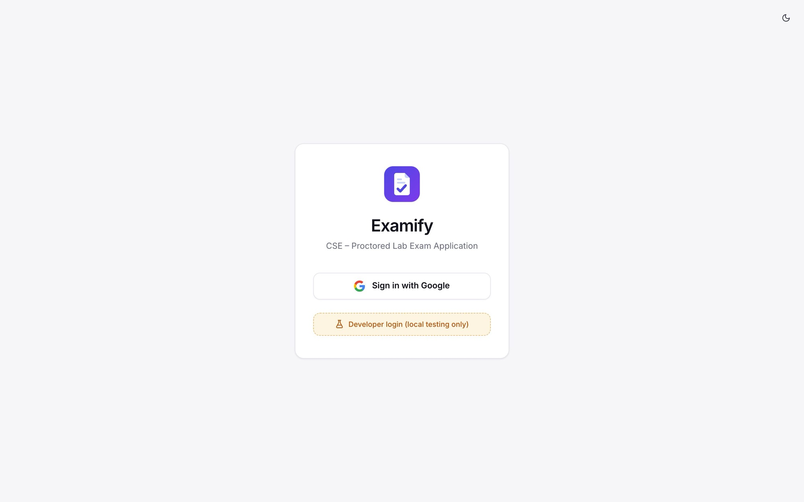</a> |

## Teacher panel

### Set up an exam

| Screen | Preview |
|---|---|
| **Your exams** — Every exam you made and the ones colleagues shared with you, with exams, live now, students added and submissions at the top. Filter by draft, published, live or ended, or search. | <a href="docs/screenshots/teacher-dashboard.jpg">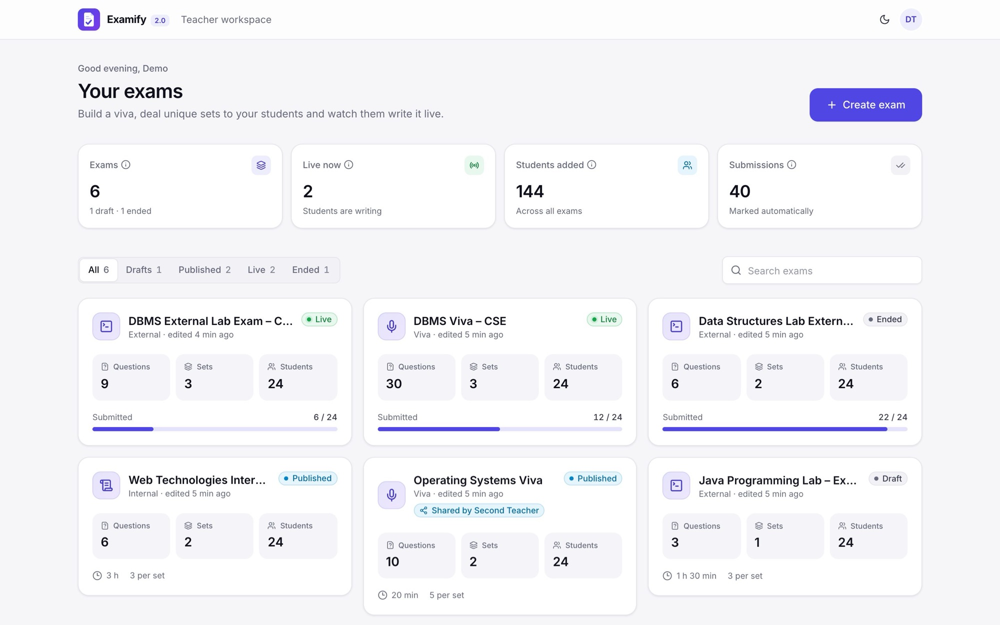</a> |
| **Create an exam** — Pick the kind of exam. A **Viva** has MCQs and fill in the blanks, marked the moment students submit. An **Internal** is a question paper in unique sets; students write their programs on their own systems. An **External** has code questions with test cases, checked by AI against your answer, so no compiler is needed. | <a href="docs/screenshots/create-exam.jpg">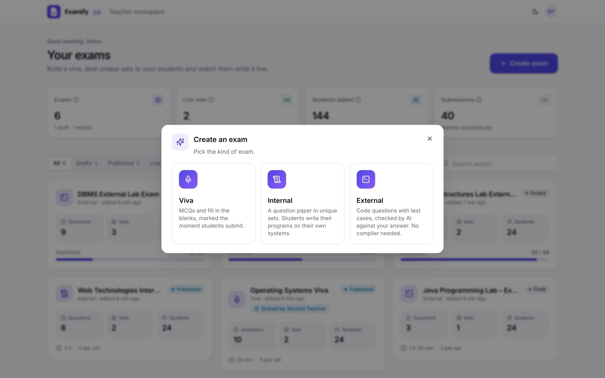</a> |
| **Exam overview** — A setup checklist (questions, sets, students, duration, teacher codes), the two teacher codes, live counts, and a summary of how the exam runs: time, shuffling, proctoring, auto-submit and AI checks. | <a href="docs/screenshots/exam-overview.jpg">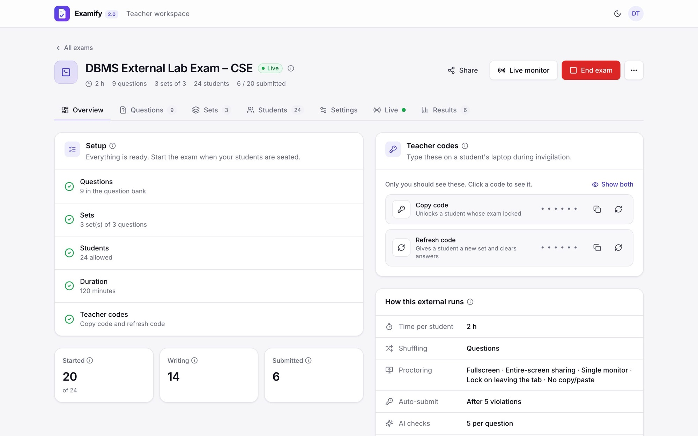</a> |
| **Share with teachers** — Co-examiners see the exam on their dashboard and run it like you: settings, sets, students, the live monitor, results and answer sheets. Only you can change its questions, share it or delete it. | <a href="docs/screenshots/share-exam.jpg">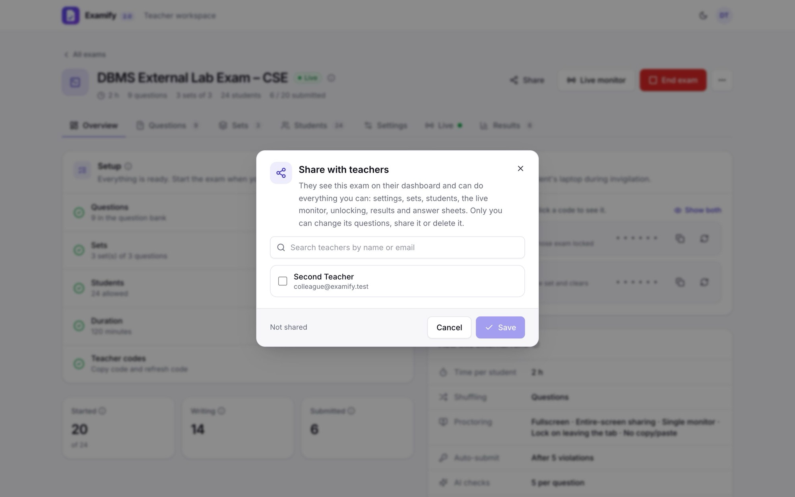</a> |
| **Questions** — The question bank, each question tagged with its language, difficulty, marks and tests. *Shared schema and data* holds the tables every DBMS question uses. When the first student starts, the questions lock so every paper stays as it was dealt. | <a href="docs/screenshots/questions.jpg">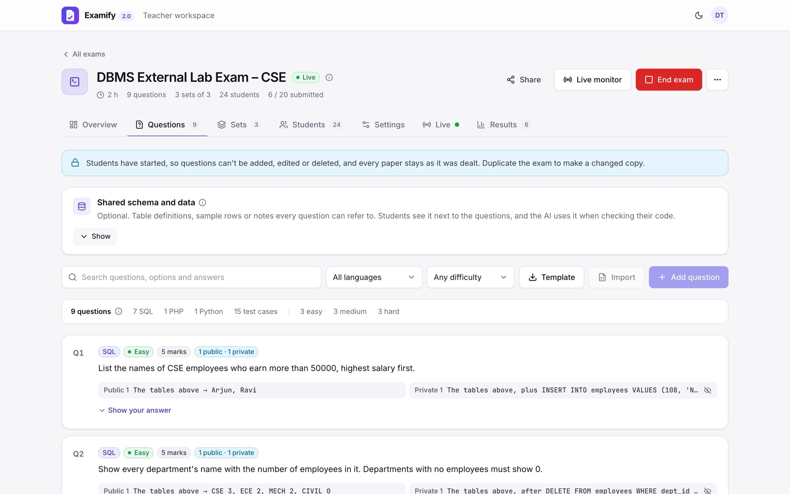</a> |
| **Code question editor** — The question and its own tables, the language (C, C++, Java, Python, SQL, PL/SQL, PHP, JavaScript, or *any* so the student picks), difficulty, marks, your answer, starter code, and up to 10 public and 10 private test cases. | <a href="docs/screenshots/question-editor.jpg">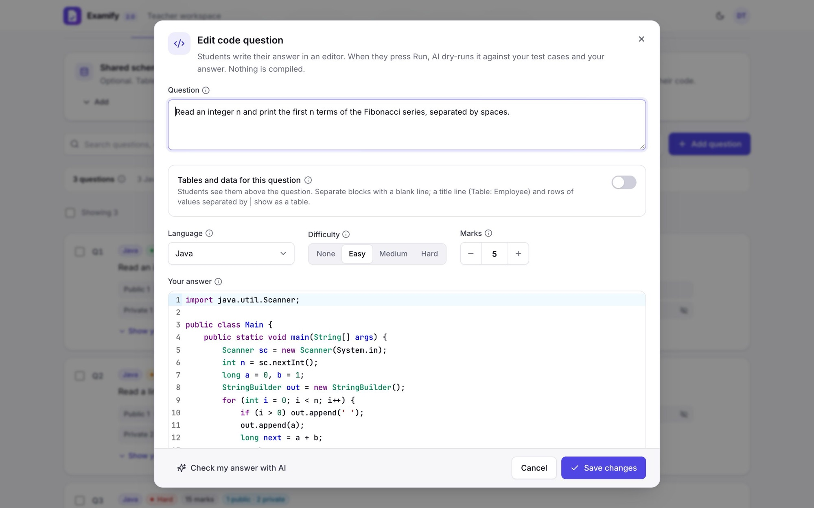</a> |
| **Check my answer with AI** — Before the exam, Gemini dry-runs your own answer against your tests. A wrong expected output shows up here, not in the exam hall. | <a href="docs/screenshots/question-ai-check.jpg">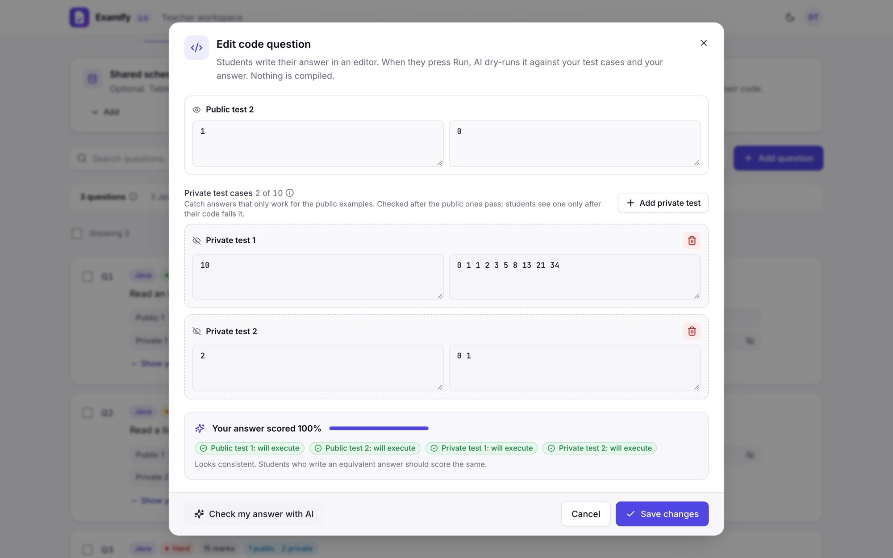</a> |
| **Import from Excel** — Upload a sheet (a template is one click away). Every row is previewed as ready, skipped or with a warning before anything is added. The columns are in the [data format guide](DATA_FORMAT_GUIDE.md). | <a href="docs/screenshots/import-questions.jpg">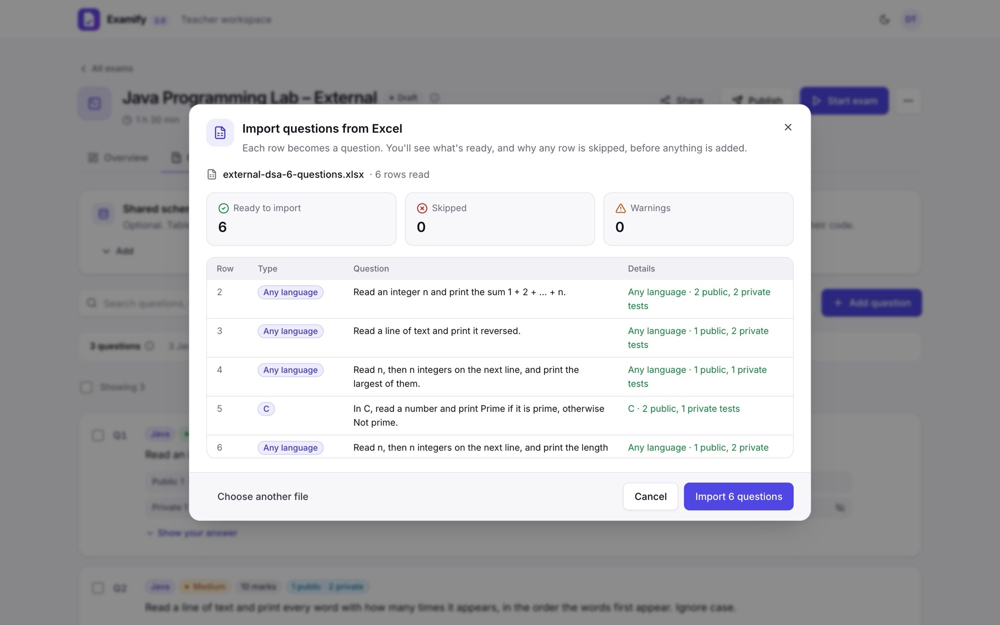</a> |
| **Sets** — Describe one set: how many questions, and how many easy, medium and hard. Examify works out how many fully unique sets the bank can make, and reuses questions only when a level runs short. Sets are dealt in roll-number order. | <a href="docs/screenshots/sets.jpg">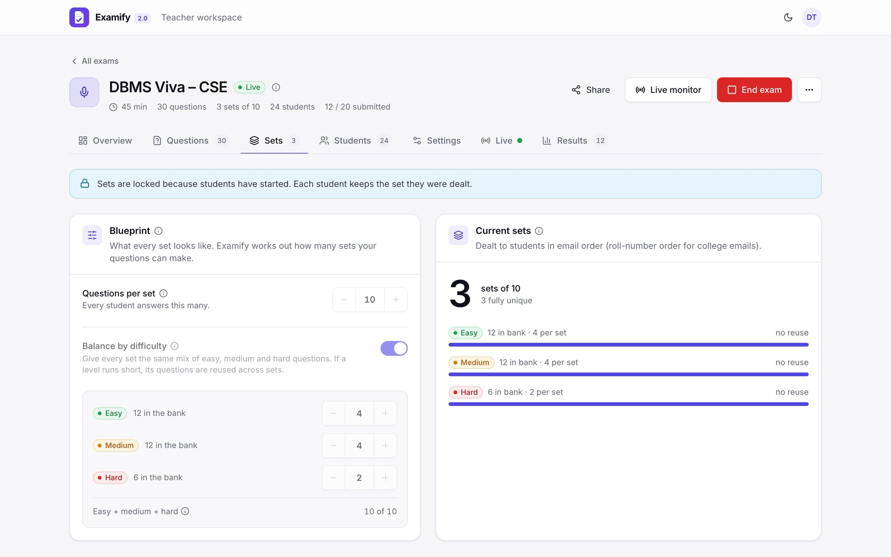</a> |
| **Students** — Paste emails or import an Excel or CSV list; only listed students can see the exam. Each row shows the roll number, set and status, and *Group by set* shows who has which paper. | <a href="docs/screenshots/students.jpg">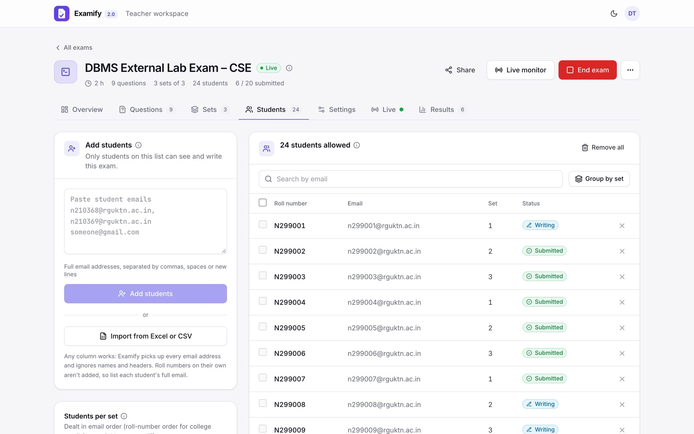</a> |
| **Settings** — Proctoring switches (fullscreen, entire-screen sharing, block second monitors, lock on leaving the tab, block copy and paste), AI checks per question, auto-submit after a number of violations, shuffling, custom teacher codes and exam details. Changing the duration mid-exam moves every writing student's deadline. | <a href="docs/screenshots/settings.jpg">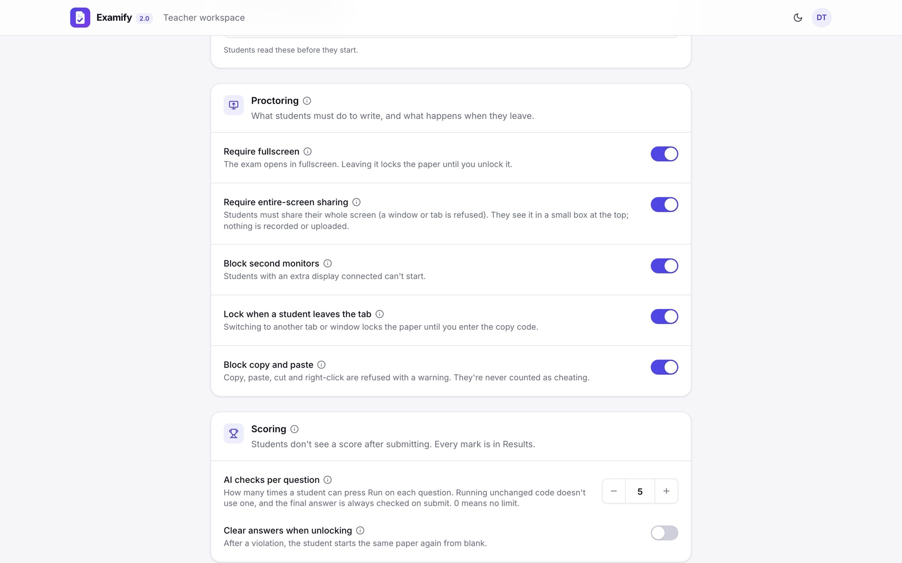</a> |

### Run it live

| Screen | Preview |
|---|---|
| **Live monitor** — The whole hall at a glance. Each student shows as writing, locked (with the reason), offline, not started or submitted, with their set, answers, violations, AI checks used, time left and when their browser last checked in. Filter, search, and keep the teacher codes beside the list. | <a href="docs/screenshots/live.jpg">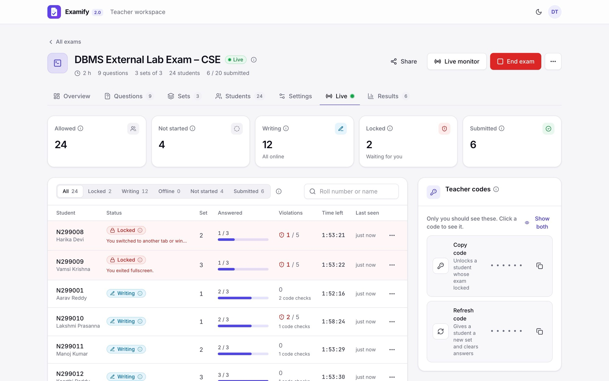</a> |
| **Row actions** — For one student: view answers, unlock, give a new set (clears answers), add 5 minutes, submit now, or reopen a sheet submitted by mistake. *Add time for everyone writing* covers a power cut or a late start, and *Fix for everyone* unlocks or unsubmits everyone at once. | <a href="docs/screenshots/live-actions.jpg">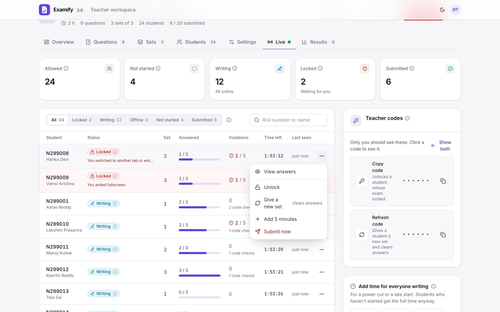</a> |
| **Confirm, with attention** — Every action except Unlock asks first and says exactly what will happen, so a stray click never changes a student's exam. | <a href="docs/screenshots/live-confirm.jpg">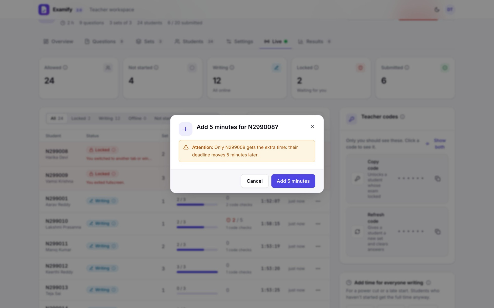</a> |
| **Answer sheet** — A student's answers, even while they write: their code, the AI result for every test, the marks (you can change them) and *Compare with your answer*. One click saves it as a PDF. | <a href="docs/screenshots/answer-drawer.jpg">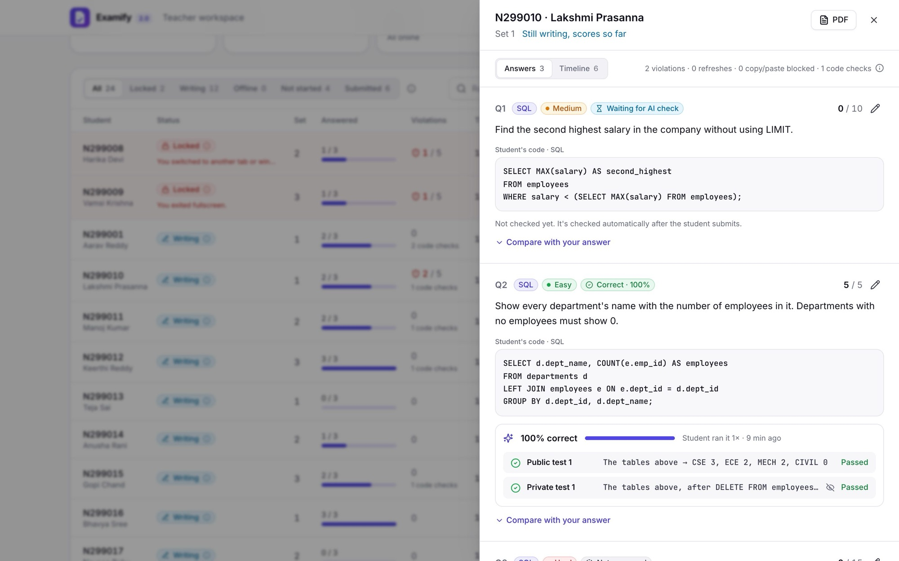</a> |
| **Timeline** — Everything that happened in the attempt, with the time: started, tab switches, fullscreen exits, unlocks, time added, rejoins and submission. | <a href="docs/screenshots/answer-timeline.jpg">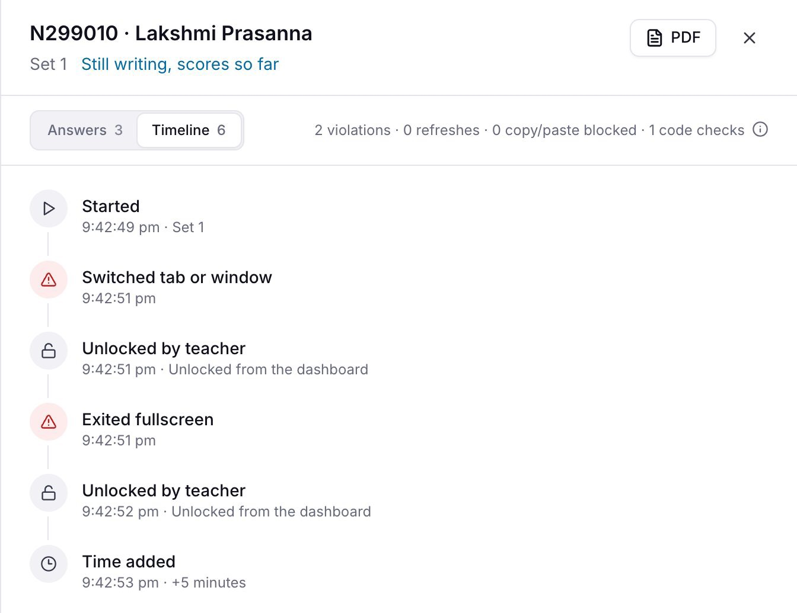</a> |

### Results

| Screen | Preview |
|---|---|
| **Results** — Submitted count, average, median, highest and lowest, a score distribution, and per-student and per-question views. *Answer sheets (PDF)* downloads every sheet in one file and *Export to Excel* gives the marks list. | <a href="docs/screenshots/results.jpg">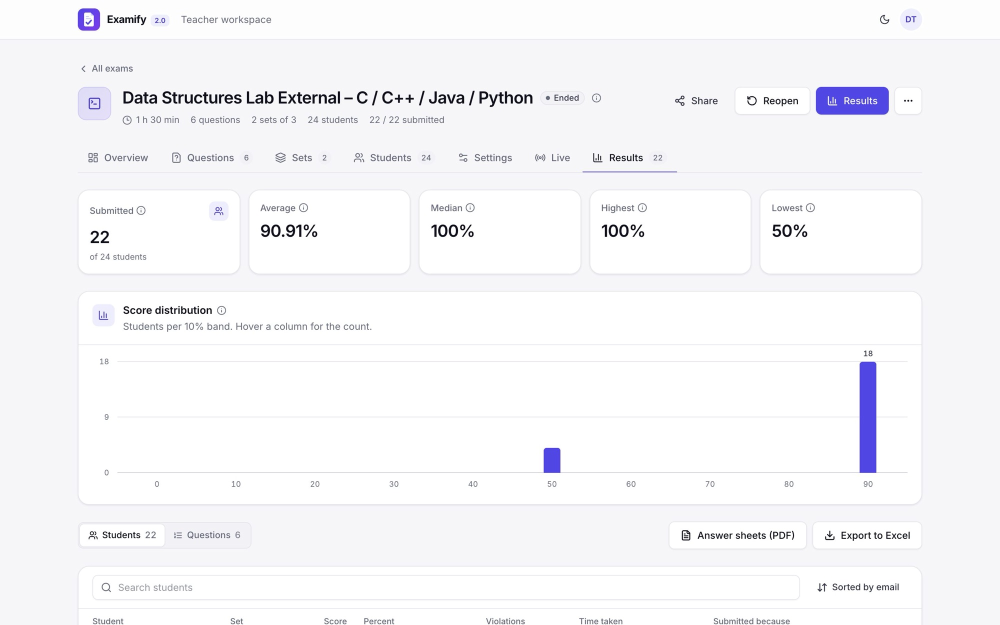</a> |
| **Marked answer sheet** — Each answer in the language the student chose, with the AI's correctness and every public and private test as passed, not passed or not run. Change marks by hand or *Re-check with AI*. | <a href="docs/screenshots/result-answer-sheet.jpg">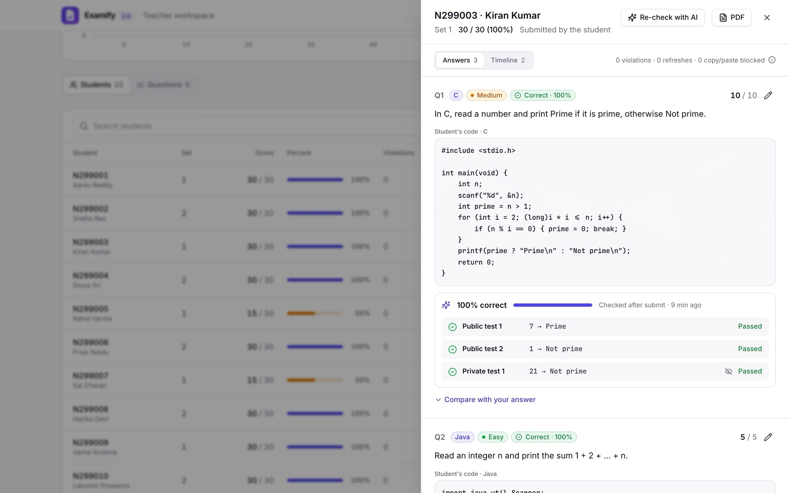</a> |

## Student panel

| Screen | Preview |
|---|---|
| **My exams** — Live exams to start or resume, upcoming ones, and completed ones. *Demo external* and *Demo viva* let students practise in the exam room before the real thing. | <a href="docs/screenshots/student-dashboard.jpg">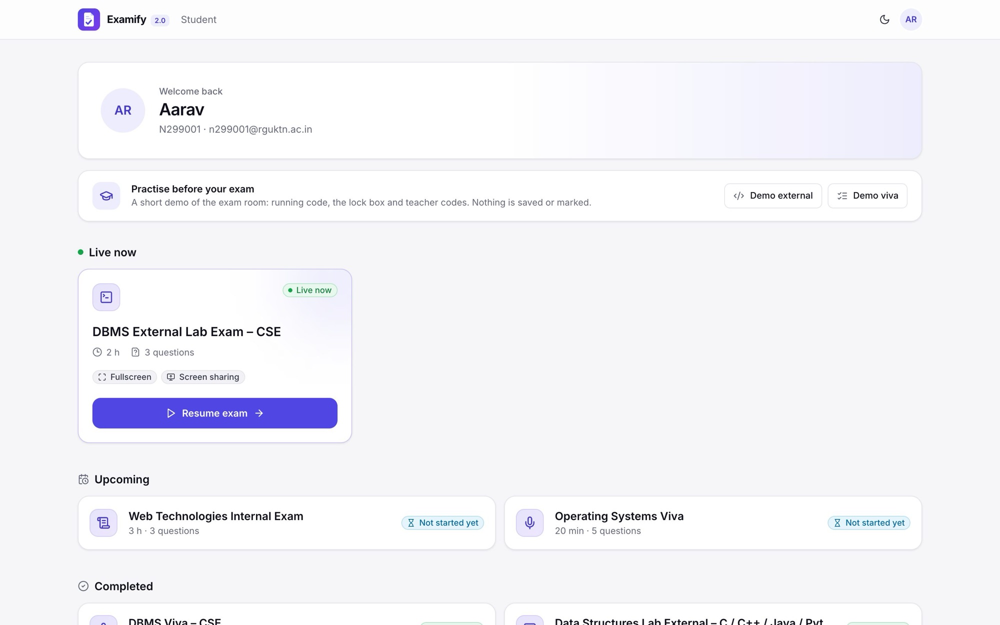</a> |
| **Before you start** — The teacher's instructions and the exam rules, then the checks: a laptop or desktop in Chrome or Edge, one screen, entire-screen sharing and fullscreen, and a promise to stay on the tab. | <a href="docs/screenshots/exam-lobby.jpg">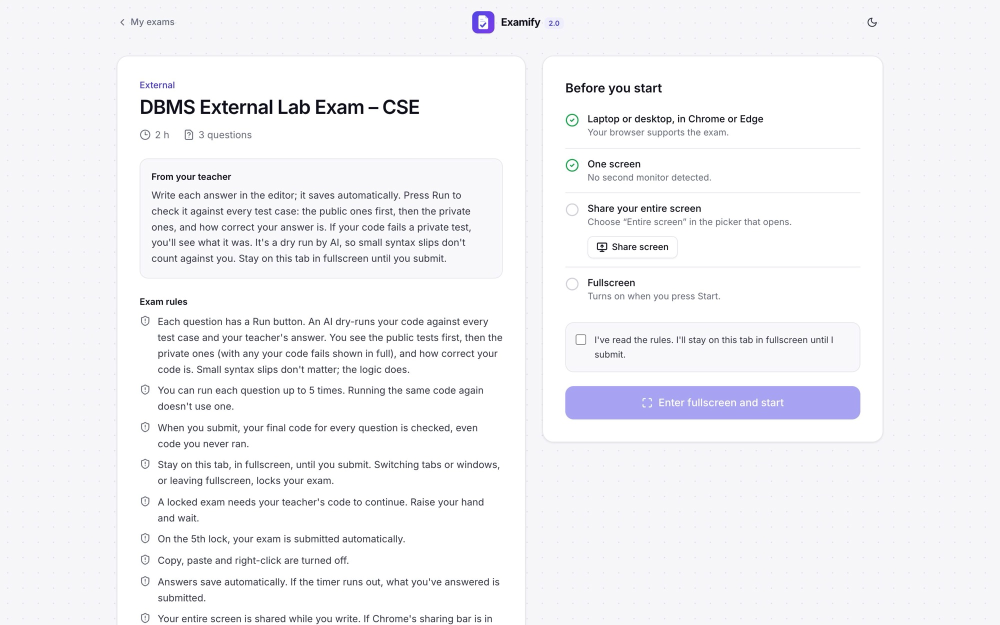</a> |
| **External exam room** — The question with its tables and test cases on the left, a code editor on the right. *Run* (or Ctrl + Enter) sends the code to Gemini, which reports public tests first, then private ones, and a % correct. The box at the top is the student's own screen share: shown to them, never recorded. Answers save automatically. | <a href="docs/screenshots/exam-room-code.jpg">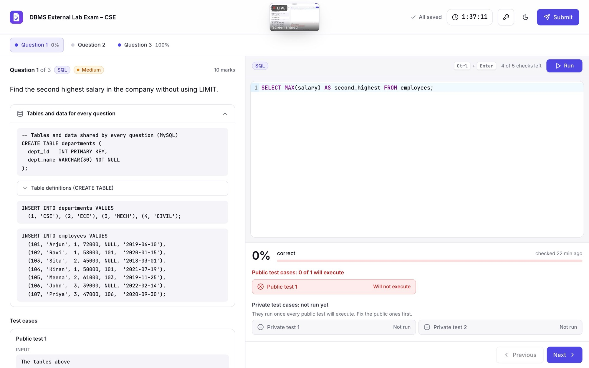</a> |
| **Every test passes** — When the code reaches the expected output, every public and private test reads *will execute*. Running unchanged code again doesn't use up a check. | <a href="docs/screenshots/exam-room-pass.jpg">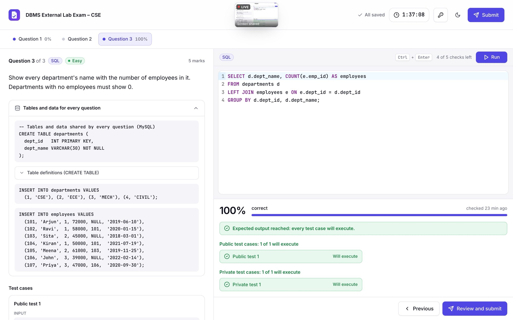</a> |
| **Viva** — One question at a time, with a palette of answered, marked-for-review and unvisited questions, keyboard shortcuts (A–D to choose, arrows to move) and *Save and next*. | <a href="docs/screenshots/exam-room-viva.jpg">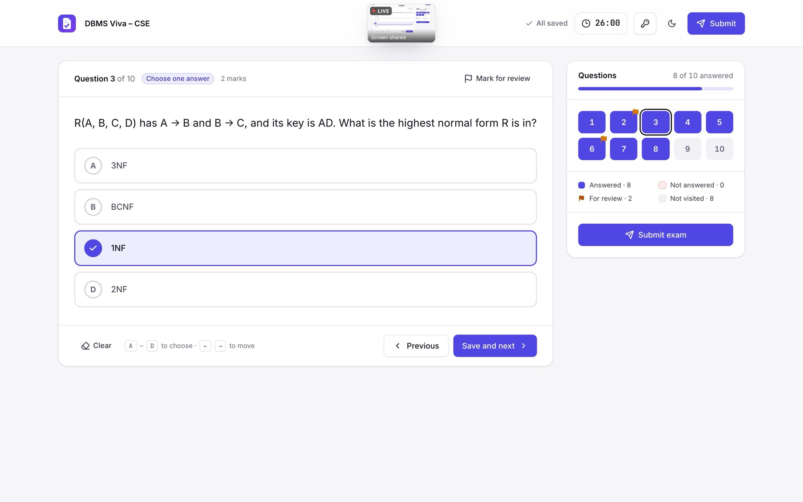</a> |
| **Locked** — Switching tabs, leaving fullscreen or stopping the screen share locks the exam until the teacher types the copy code or unlocks it from the dashboard. The 5th lock submits the exam automatically. | <a href="docs/screenshots/exam-locked.jpg">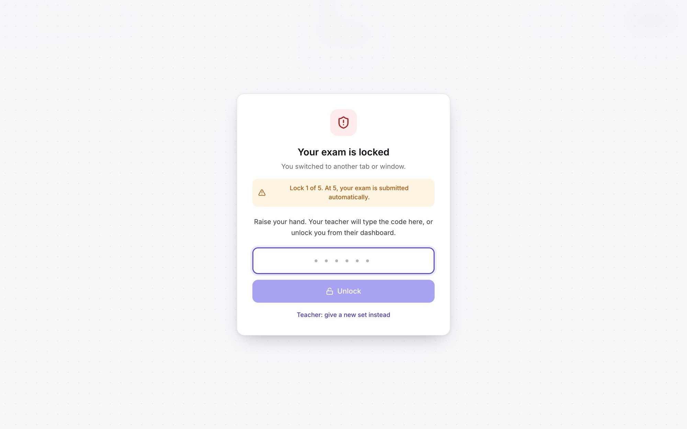</a> |
| **Internal question paper** — The student's set as a paper, with marks per question and a timer. They write the programs on their lab system and press *Finish*. | <a href="docs/screenshots/internal-paper.jpg">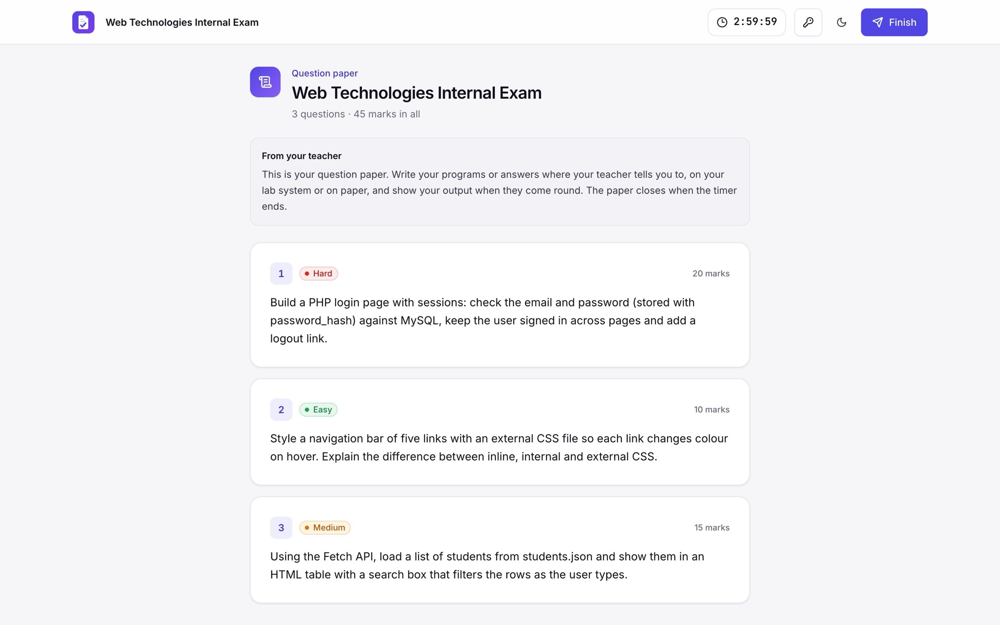</a> |
| **Submitted** — A clear confirmation. Students never see a score; the marks stay with the teacher. | <a href="docs/screenshots/exam-submitted.jpg">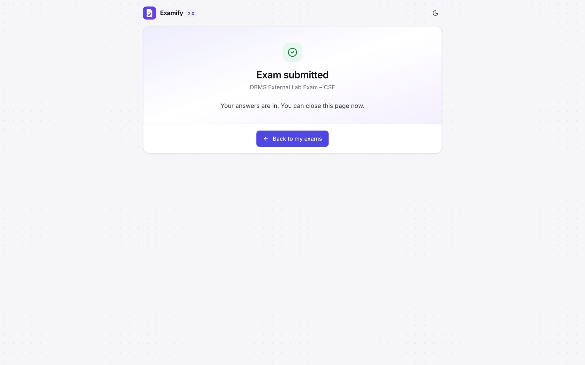</a> |
| **Demo exam** — A practice external with a guided walkthrough of the room: running code, the lock box and teacher codes. Nothing is saved or marked. | <a href="docs/screenshots/demo-external.jpg">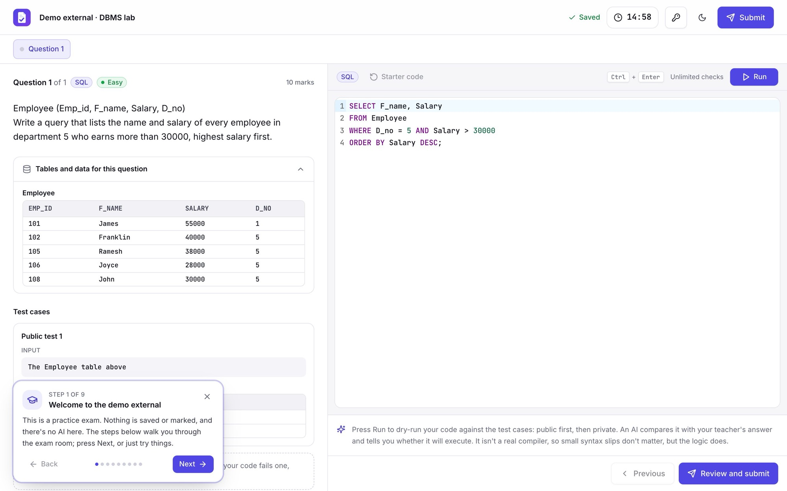</a> |

## Dark mode

| Screen | Preview |
|---|---|
| **Dark mode** — Every screen, for teachers and students, has a dark theme. Switch it with the moon icon in the header. | <a href="docs/screenshots/live-dark.jpg">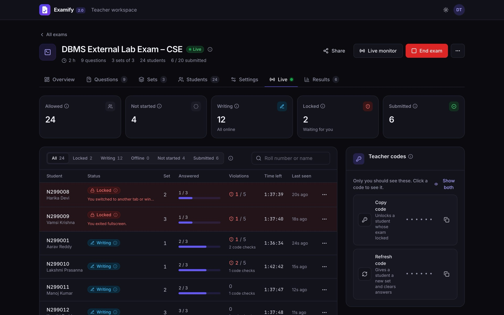</a> |
