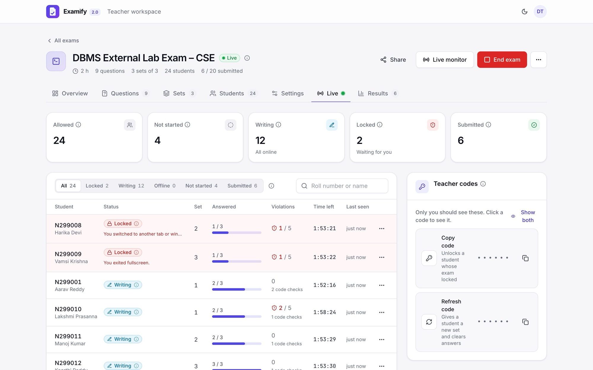

<p align="center">
  
</p>

<h1 align="center">Examify</h1>

<p align="center">
  <b>Proctored lab exams for RGUKT: vivas, internals and externals, with AI-checked code.</b><br>
  Version 2.0
</p>

<p align="center">
  <a href="https://wtexamify-ojmz.vercel.app"><b>Open Examify</b></a> ·
  <a href="APP_TOUR.md"><b>App tour</b></a> ·
  <a href="#run-it-locally"><b>Run it locally</b></a> ·
  <a href="#contact"><b>Contact</b></a>
</p>

<p align="center">
  <a href="APP_TOUR.md"></a>
</p>

| 1,000+ | 2,000+ | 40+ |
|:---:|:---:|:---:|
| students have written exams on it | answer sheets | real exams |

## What is Examify?

Examify is an online exam platform for lab exams at RGUKT. A teacher builds the exam and Examify deals every student a unique set. Students write it in a proctored exam room while the teacher watches the whole hall live, and marked answer sheets are ready when it ends.

**It is only for RGUKT.** Students sign in with their RGUKT Google account (`@rguktn.ac.in`), and only approved faculty get the teacher panel.

This is **Examify 2.0**, a full rebuild of the first version, shaped by more than a year of real exams on it. Exams can be in any subject and any language: DBMS, Data Structures, Java, Web Technologies, Operating Systems and more, written in C, C++, Java, Python, SQL, PL/SQL, PHP or JavaScript.

| Exam | How it works |
|---|---|
| **Viva** | MCQs (one or several answers) and fill in the blanks, marked the moment a student submits. |
| **Internal** | A question paper in unique sets. Students write their programs on their lab systems. |
| **External** | Code questions with public and private test cases, LeetCode style. There is no compiler: Google Gemini dry-runs each student's code against the teacher's answer, and marks follow how many tests will execute. |

**Highlights**

- **Unique sets**, balanced by difficulty and dealt in roll-number order.
- **Proctored exam room**: fullscreen, entire-screen sharing, one monitor only, a lock on every tab switch, copy and paste blocked, and auto-submit after 5 locks.
- **Live monitor**: see who is writing, locked, offline or done, and unlock, add time, give a new set or reopen a sheet in one click.
- **AI-checked code**: students can run their code a few times per question, and an answer that matches the teacher's passes straight away.
- **Results**: average, median, score distribution, per-question stats, every answer sheet as a PDF, and export to Excel.
- **Shared exams**: co-examiners can run an exam with its owner.

See every screen in the **[App tour](APP_TOUR.md)**.

## Tech stack

| Layer | Technology |
|---|---|
| Frontend | React 19, Vite 6, Tailwind CSS 3, React Router 7, CodeMirror 6 (code editor), jsPDF (answer sheets), SheetJS (Excel import and export) |
| Backend | Go 1.24, Gin, MongoDB Go driver, JWT |
| AI | Google Gemini, which dry-runs code against the teacher's answer and test cases, with fallbacks across models and keys |
| Sign-in | Google OAuth 2.0: RGUKT emails for students, approved emails for teachers |
| Database | MongoDB Atlas |
| Hosting | Vercel (frontend), Render (backend) |

## Run it locally

You need Go 1.24+, Node.js 20+ and a MongoDB database (the Atlas free tier works).

**1. Backend**

```bash
cd backend
```

```bash
cp .env.example .env
```

Fill in `MONGODB_URI`, `JWT_SECRET` and `GEMINI_API_KEY` in `backend/.env`. The Google sign-in keys are optional for local use. Then start it:

```bash
go run .
```

**2. Frontend**, in a second terminal:

```bash
cd frontend
```

```bash
npm install
```

```bash
npm run dev
```

**3. Sign in** at http://localhost:5173/dev. With `APP_ENV=development` the developer login signs you in as a test teacher or student without Google. Sample questions and students to import are in [`samples/`](samples/README.md), and the spreadsheet columns are in the [data format guide](DATA_FORMAT_GUIDE.md).

## Thanks

Examify was built at the request of [Vasu Neninthe Sir](https://www.linkedin.com/in/vasu-neninthe/), who trusted it with real exams from the very first one. Thank you, sir.

## Contact

Built by **Mahesh Karri**. For updates, for using Examify in your exams, or for feedback:

- Email: [maheshkarri2109@gmail.com](mailto:maheshkarri2109@gmail.com)
- LinkedIn: [linkedin.com/in/maheshkarri4444](https://www.linkedin.com/in/maheshkarri4444/)
- GitHub: [Maheshkarri4444](https://github.com/Maheshkarri4444)
